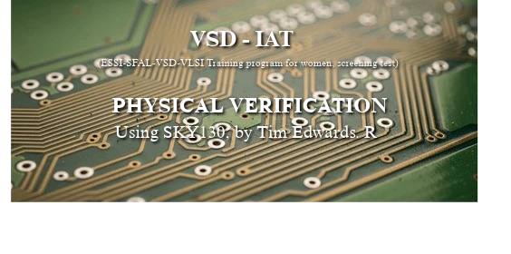

# Sky130A_Inverter_byhema


This repository contains documentation, code snippets and supporting photos captured while designing a CMOS inverter on Open-source PDK, SkyWater-130.This project is an outcome of the screening test for ESSCI-SFAL-VSD VLSI Training program for Women.Learn more at https://vsdiat.vlsisystemdesign.com/

This repo explains, the steps followed and errors faced during the physical verification of a CMOS inverter using Open-pdk tools. The verification is mainly carried out by Skywater 130 nm tech, including drawing schematics, layouts, DRC checks ,LVS etc. Continue reading to understand the procedure.

A Special thanks to Tim, Kunal and Anagha Ghosh and participating institutions for this chance.

[R Timothy Edwards](https://github.com/RTimothyEdwards) 

[Kunal Ghosh](https://github.com/kunalg123)

## INDEX

 -[Chapter 0 - Setting up the Linux Environement](#chapter-0)

  ## SETTING UP THE LINUX ENVIRONMENT

  ->To be able to operate with the design tools, we need a working Linux environment.
  
  ->To host that working Linux OS, firstly we need a medium to handle this. For this project we opted Virtual Box by Oracle 
  Learn more at [VirtualBox](https://www.virtualbox.org/)
  
  -> For the working Linux OS , download Ubuntu (latest version) at [Ubuntu ISO](https://ubuntu.com/)

  ->Create the Virtual Machine with certain specifications that support all the necessary tools

 ```bash
$ sudo apt-get update

$ mkdir -p eda_tools
$ cd eda_tools

$ sudo apt-get install build-essential clang bison flex \
 $   libreadline-dev gawk tcl-dev libffi-dev git \
 $  graphviz xdot pkg-config python3 libboost-system-dev \
 $   libboost-python-dev libboost-filesystem-dev zlib1g-dev \
 $    make m4 tcsh csh libx11-dev gperf tcl8.6-dev tk8.6 \
 $   libxpm-dev libxcb1 libxaw7-dev freeglut3-dev automake yosys

$ sudo apt-get update
$ sudo apt-get -y install libtool
```

Now to set up the design lab, we first need to install the tools supported by the open source pdk

  

_Note: open_pdk has to be installed last so it can correctly associate the xschem and magic directories. Note: if the configure step fails during any process, its most likely due to missing additional packages, and they need to be installed (preferably from source) to complete the installation_

## Tools Set-up

For the design and simulation of our Inverter.

Spice netlist simulation - Ngspice

Layout Design and DRC - Magic

LVS - Netgen

Schematic Capture - Xschem

_Make sure all the libraries that are necessary for all these below software are installed in your system. Also this would cost a lot of space as well so I suggest to get atleast 50GB of storage and atleast 8GB RAM._

## Magic


Magic is a VLSI layout tool.

```bash
$  git clone git://opencircuitdesign.com/magic
$  cd magic
$	 ./configure
$  make
$  sudo make install
```


