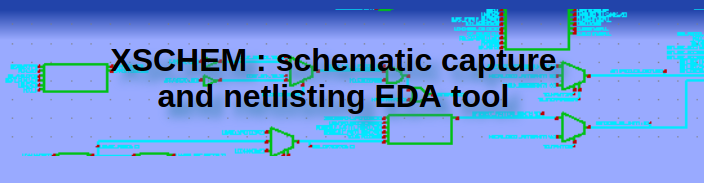
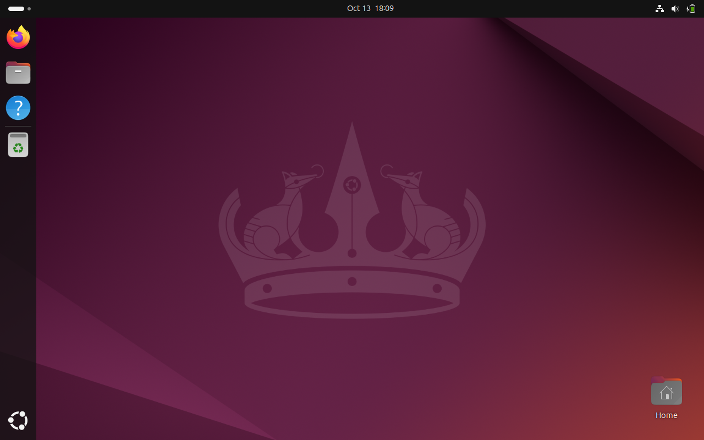
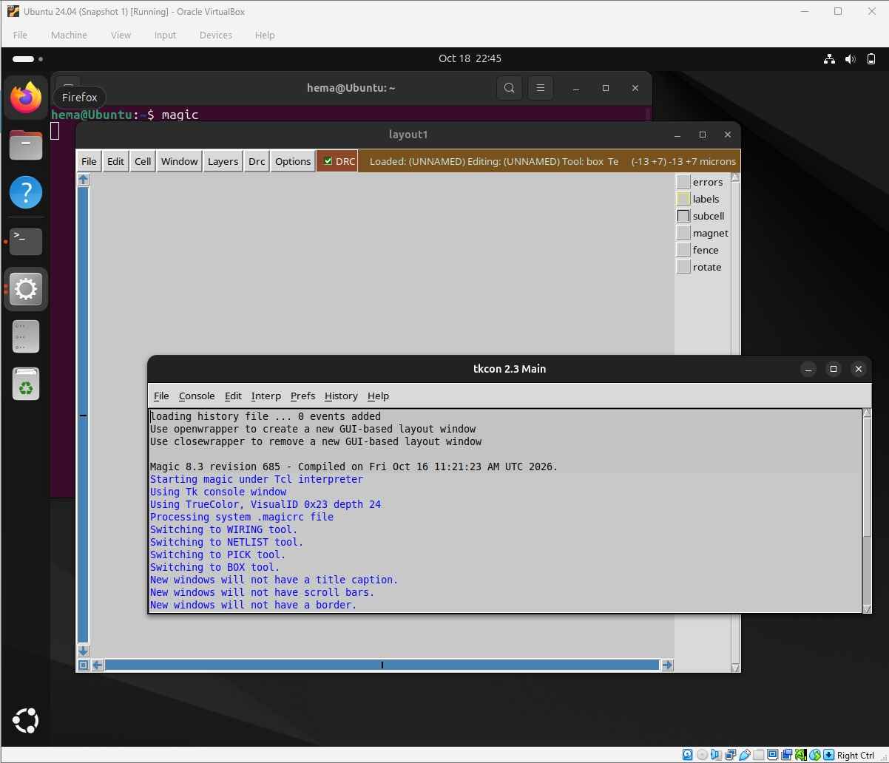
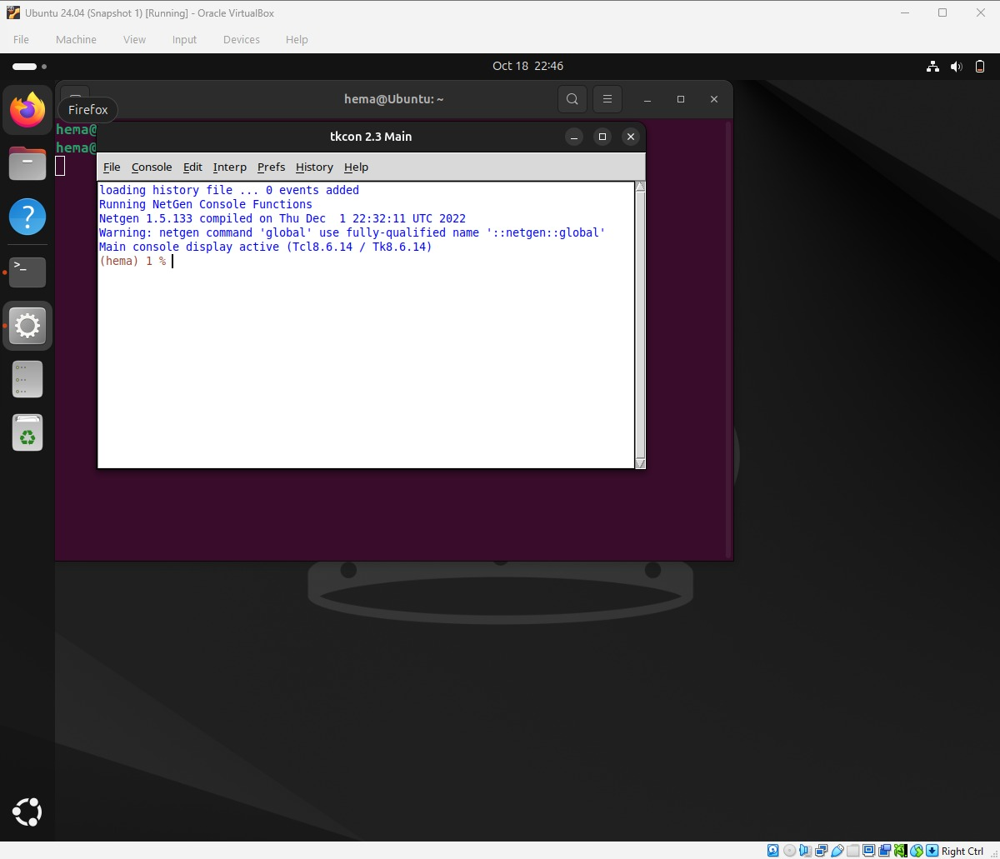
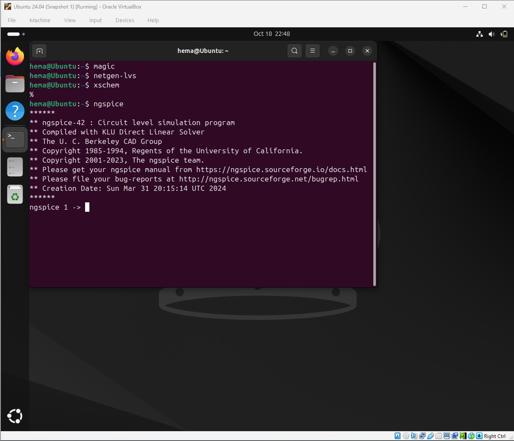
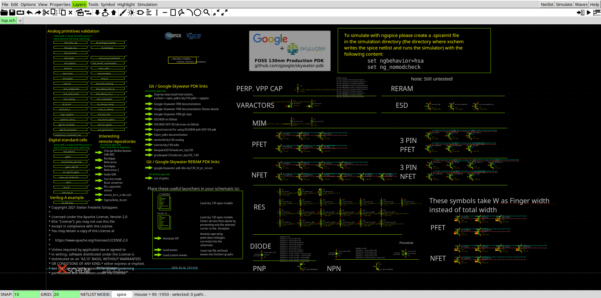

# Sky130A_Inverter_byhema


This repository contains documentation, code snippets and supporting photos captured while designing a CMOS inverter on Open-source PDK, SkyWater-130.This project is an outcome of the screening test for ESSCI-SFAL-VSD VLSI Training program for Women.Learn more at https://vsdiat.vlsisystemdesign.com/

This repo explains, the steps followed and errors faced during the physical verification of a CMOS inverter using Open-pdk tools. The verification is mainly carried out by Skywater 130 nm tech, including drawing schematics, layouts, DRC checks ,LVS etc. Continue reading to understand the procedure.

A Special thanks to Tim, Kunal and Anagha Ghosh and participating institutions for this chance.

[R Timothy Edwards](https://github.com/RTimothyEdwards) 

[Kunal Ghosh](https://github.com/kunalg123)

## INDEX

- [Chapter-0 Setting Up the Linux Environment](#chapter-0-setting-up-the-linux-environment)
- [Chapter-1 Understanding the Design flow](#chapter-1-understanding-the-design-flow)
- [Chapter-2 Inverter creation](#chapter-2-inverter-creation)

  ## Chapter-0 Setting Up the Linux Environment

  ->To be able to operate with the design tools, we need a working Linux environment.
  
  ->To host that working Linux OS, firstly we need a medium to handle this. For this project we opted Virtual Box by Oracle 
  Learn more at [VirtualBox](https://www.virtualbox.org/)
  
  -> For the working Linux OS , download Ubuntu (latest version) at [Ubuntu ISO](https://ubuntu.com/)

  ->Create the Virtual Machine with certain specifications that support all the necessary tools

 ```bash
$ sudo apt-get update

$ mkdir -p eda_tools
$ cd eda_tools

$ sudo apt-get install build-essential clang bison flex \
 $   libreadline-dev gawk tcl-dev libffi-dev git \
 $  graphviz xdot pkg-config python3 libboost-system-dev \
 $   libboost-python-dev libboost-filesystem-dev zlib1g-dev \
 $    make m4 tcsh csh libx11-dev gperf tcl8.6-dev tk8.6 \
 $   libxpm-dev libxcb1 libxaw7-dev freeglut3-dev automake yosys

$ sudo apt-get update
$ sudo apt-get -y install libtool
```

Now to set up the design lab, we first need to install the tools supported by the open source pdk

  

_Note: open_pdk has to be installed last so it can correctly associate the xschem and magic directories. Note: if the configure step fails during any process, its most likely due to missing additional packages, and they need to be installed (preferably from source) to complete the installation_

## Tools Set-up

For the design and simulation of our Inverter.

Spice netlist simulation - Ngspice

Layout Design and DRC - Magic

LVS - Netgen

Schematic Capture - Xschem

_Make sure all the libraries that are necessary for all these below software are installed in your system. Also this would cost a lot of space as well so I suggest to get atleast 50GB of storage and atleast 8GB RAM._

## Magic


Magic is a VLSI layout tool.

Install using:

```bash
$  git clone git://opencircuitdesign.com/magic
$  cd magic
$	 ./configure
$  make
$  sudo make install
```

More info can be found at http://opencircuitdesign.com/magic/index.html


## Netgen


Netgen is a tool for comparing netlists, a process known as LVS, which stands for "Layout vs. Schematic". This is an important step in the integrated circuit design flow, ensuring that the geometry that has been laid out matches the expected circuit.

Install using:

```bash
$  git clone git://opencircuitdesign.com/netgen
$  cd netgen
$	./configure
$  make
$  sudo make install
```

More info can be found at http://opencircuitdesign.com/netgen/index.html


## Xschem


Xschem is a schematic capture program that allows to interactively enter an electronic circuit using a graphical and easy to use interface. When the schematic has been created a circuit netlist can be generated for simulation.

Install using:

```bash
$  git clone https://github.com/StefanSchippers/xschem.git xschem_git
$	./configure
$  make
$  sudo make install
```

More info can be found at http://repo.hu/projects/xschem/index.html

## Ngspice


Ngspice is the open source spice simulator for electric and electronic circuits. Ngspice is an open project, there is no closed group of developers.

nstall steps:

After downloading the tarball from https://sourceforge.net/projects/ngspice/files/ to a local directory, unpack it using:

```bash
 $ tar -zxvf ngspice-37.tar.gz
 $ cd ngspice-37
 $ mkdir release
 $ cd release
 $ ../configure  --with-x --with-readline=yes --disable-debug
 $ make
 $ sudo make install
```
More info can be found at https://ngspice.sourceforge.io/index.html

Please note that to view the simulation graphs of ngspice, xterm is required and can be installed using.

## PDK Setup


A process design kit (PDK) is a set of files used within the semiconductor industry to model a fabrication process for the design tools used to design an integrated circuit. The PDK is created by the foundry defining a certain technology variation for their processes. It is then passed to their customers to use in the design process.

The PDK we are going to use for this BGR is Google Skywater-130 (130 nm) PDK.

Steps to download PDK - Open the terminal and type the following to download sky130 PDK.

```bash
$  git clone https://github.com/RTimothyEdwards/open_pdks.git
$  cd open_pdks
$  ./configure [options]
$  make
$  [sudo] make install
```

##  Chapter-1 Understanding the Design flow

# Verifying the Open-PDKs 

An initial working directory can be made by copying the required files as follows:

```bash
$ mkdir Lab1_and
$ cd Lab1_and
$ mkdir mag
$ mkdir netgen
$ mkdir xschem
$ cd xschem
$ cp /usr/local/share/pdk/sky130A/libs.tech/xschem/xschemrc .
$ cp /usr/local/share/pdk/sky130A/libs.tech/ngspice/spinit .spiceinit
$ cd ../mag
$ cp /usr/local/share/pdk/sky130A/libs.tech/magic/sky130A.magicrc .magicrc
$ cd ../netgen
$ cp /usr/local/share/pdk/sky130A/libs.tech/netgen//sky130A_setup.tcl .
```

***Note: Due to technical issues from my side (my laptop) I couldn't download the latest version of Ubuntu (used an older version 24.04), even after that I had errors piling up with the device specifications during designing  ,so I couldn't follow the exact specifications mentioned in the lectures by sir Tim , so these outputs may vary accordingly.***

Setup and the welcome window of Linux OS (Ubuntu VM):



_Note:The timestamps should be disregarded as the time zone settings were incorrect_

Checking tools,Magic:



Verifying Netgen:



Verifying Ngspice:



Verifying Xschem(and added libraries)



## Chapter-2 Inverter creation

# Step-1: Creating Inverter schematic using Xschem tool

The process includes choosing the MOSFETs for the design such as PMOS , NMOS. Inset these symbols from previously installed Sky130 libraries and make the inverter schematic

!{inverter]()


